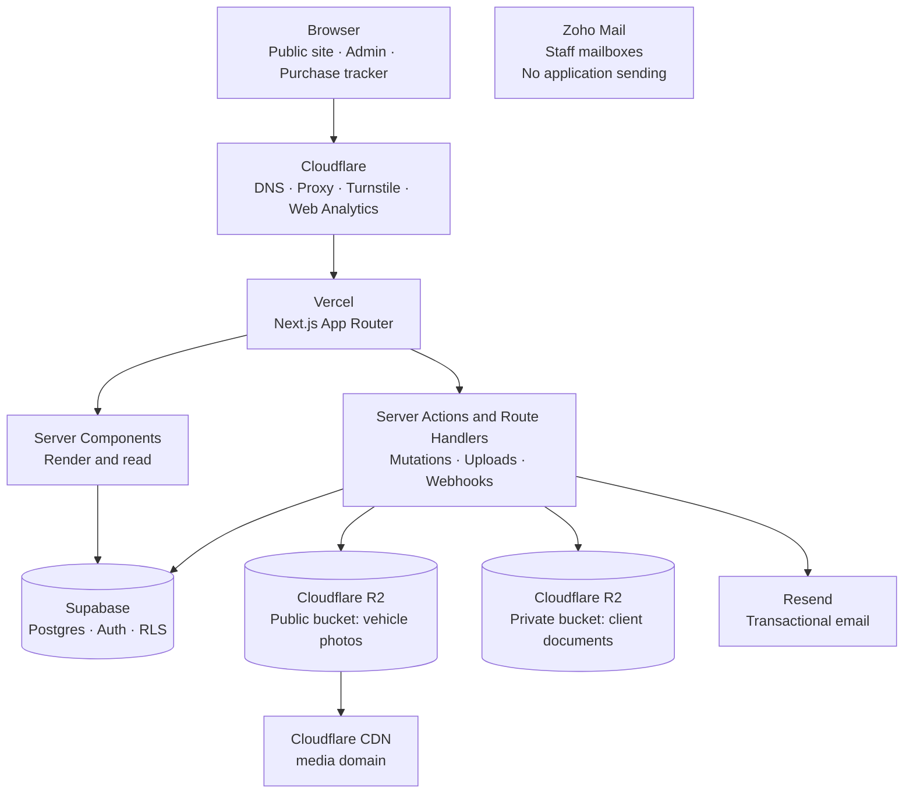

# KHANS TRADING Ltd

**Vehicle trading platform for Kenya: a public vehicle storefront, a purchase tracker and an internal administration portal.**

> **Repository status: pre-development.**
> This repository currently contains project documentation and AI agent configuration only. There is no `package.json`, application source, database migration, test or deployment configuration. Every application feature described below is a documented requirement, not working software. See [Current Implementation Status](#19-current-implementation-status).

---

## Table of Contents

1. [Project Title and Introduction](#1-project-title-and-introduction)
2. [About KHANS TRADING Ltd](#2-about-khans-trading-ltd)
3. [Project Vision and Objectives](#3-project-vision-and-objectives)
4. [Key Platform Features](#4-key-platform-features)
5. [Technology Stack](#5-technology-stack)
6. [System Architecture](#6-system-architecture)
7. [Application Architecture and Folder Structure](#7-application-architecture-and-folder-structure)
8. [Authentication, RBAC and Security](#8-authentication-rbac-and-security)
9. [Database and Data Management](#9-database-and-data-management)
10. [Third-Party Integrations](#10-third-party-integrations)
11. [Design System and UI/UX](#11-design-system-and-uiux)
12. [Project Requirements and Prerequisites](#12-project-requirements-and-prerequisites)
13. [Installation and Local Development](#13-installation-and-local-development)
14. [Environment Variables](#14-environment-variables)
15. [Development Scripts](#15-development-scripts)
16. [Testing and Quality Assurance](#16-testing-and-quality-assurance)
17. [Deployment and Hosting](#17-deployment-and-hosting)
18. [Development Workflow and AI Agent Guidelines](#18-development-workflow-and-ai-agent-guidelines)
19. [Current Implementation Status](#19-current-implementation-status)
20. [Roadmap](#20-roadmap)
21. [Contributing and Code Standards](#21-contributing-and-code-standards)
22. [Known Documentation Gaps and Conflicts](#22-known-documentation-gaps-and-conflicts)
23. [Documentation Index](#23-documentation-index)

---

## 1. Project Title and Introduction

KHANS TRADING Ltd is a vehicle trading company in Kenya. This repository holds the specification, and eventually the implementation, of its platform: a public, e-commerce-style website for discovering and buying vehicles, and a private administration portal for the staff who manage stock, deals, documents, payments and imports.

The platform is specified as a single Next.js application backed by Supabase, with Cloudflare for DNS, media delivery and bot protection. There is no separate always-on backend service; server code runs as serverless functions on Vercel ([ARCHITECTURE.md](ARCHITECTURE.md), Section 1).

**At a glance**

| Item | Value |
|---|---|
| Repository status | Pre-development: documentation and agent configuration only |
| Product | Public vehicle marketplace, purchase tracker and staff admin portal |
| Market | Kenya; prices in Kenyan shillings (`KSh 3,450,000` format) |
| Approved application stack | Next.js App Router, React, TypeScript (strict), Tailwind CSS, Supabase |
| Approved hosting | Vercel; Cloudflare DNS, proxy, Turnstile |
| Approved media storage | Cloudflare R2 (see [Section 22](#22-known-documentation-gaps-and-conflicts) for a conflict with AGENTS.md) |
| Package manager | pnpm |
| Source control | GitHub (`crypto-surgelitu/KhanTradingLtd`), default branch `main` |
| Licence | Not stated in the repository |

What exists today: the governing rules, the design system and screen specifications, the architecture and integrations documents, the OpenCode agent configuration, and this README. Nothing else.

---

## 2. About KHANS TRADING Ltd

KHANS TRADING Ltd sells vehicles online and in person in Kenya. Vehicles may be local stock or imports. Payments are mostly bank transfer, finance and cash; M-Pesa is optional and secondary (AGENTS.md, Section 3).

The brand is specified as refined, confident, calm and trustworthy: a private showroom rather than a car auction. The editable tagline placeholder is "Premium vehicles. Honest dealing." (DESIGN.md, Section 1).

Business details are intentionally placeholders until the owner supplies real values: `[PHONE]`, `[WHATSAPP]`, `[EMAIL]`, `[ADDRESS]`, `[YEAR FOUNDED]`, `[BANK NAME]`, `[ACCOUNT NAME]`, `[ACCOUNT NUMBER]` and `[BRANCH]`. They will be centralised in `src/config/site.ts`, which does not exist yet. No real contact details, statistics, testimonials or awards are recorded in this repository, and none should be invented.

---

## 3. Project Vision and Objectives

The design and engineering documents define the following objectives:

- **Make the vehicle the hero.** Large, clean photography, with the interface staying quiet around it (DESIGN.md, Section 2.1).
- **Commerce clarity within two seconds.** Price, status, key specifications and the next action must always be obvious (DESIGN.md, Section 2.4).
- **Mobile first.** Most buyers browse on phones; the site is designed at 360px first and scaled up (DESIGN.md, Sections 2.5 and 10).
- **Give staff one operational system.** Inventory, deals, documents, payments, financing, viewings, costing, shipments and enquiries belong in one admin portal (DESIGN.md, Section 8).
- **Protect client data by design.** ID documents, KRA PINs, payment and finance details are collected under the Kenya Data Protection Act, 2019, with role-based access and audited document access (AGENTS.md, Sections 8 and 13).
- **Stay maintainable.** Typed boundaries, one approved stack, feature-first structure, migrations, tests and documented decisions (AGENTS.md, Sections 5, 7 and 8).
- **Meet measurable quality targets.** Mobile Lighthouse at least 90 across Performance, Accessibility, Best Practices and SEO on core pages; WCAG AA; no horizontal page scroll at any supported width (AGENTS.md, Sections 7 and 9).

---

## 4. Key Platform Features

All items in this section are **planned**. They are specified in [DESIGN.md](DESIGN.md) and no corresponding code exists yet.

### 4.1 Public Website

| Area | Capability | Specification |
|---|---|---|
| Home | Hero, trust strip, body-type browsing, featured vehicles, collections, makes, buying steps, trade-in band, new arrivals, FAQ, showroom | DESIGN.md, Screen 1 |
| Vehicles | Server-side search, filters, sort, grid/list toggle, pagination, empty state | DESIGN.md, Screen 2 |
| Vehicle Detail | Gallery and lightbox, price, specifications, features, documents note, finance estimate, similar vehicles | DESIGN.md, Screen 3 |
| Reserve | Stepper for details and deposit; bank transfer, showroom payment, finance and optional M-Pesa; order summary | DESIGN.md, Screen 6 |
| Track Your Purchase | Reference and phone lookup, one-time code, progress timeline, documents, payments, updates, notification preferences | DESIGN.md, Screens 6A and 6B |
| Book a Viewing | Viewing or test drive, date and time slot, details, confirmation | DESIGN.md, Screen 6C |
| Request a Vehicle | Structured sourcing request with budget, preferences and contact details | DESIGN.md, Screen 6D |
| Saved and Compare | Saved vehicle grid and side-by-side comparison of up to three vehicles | DESIGN.md, Screens 7 and 8 |
| Sell or Trade In | Three-step explanation and submission form with photo upload | DESIGN.md, Screen 9 |
| About and Contact | Company story, values, sourcing process, team placeholders, contact form and details | DESIGN.md, Screens 4 and 5 |
| FAQ and How to Buy | Searchable, grouped accordion | DESIGN.md, Screen 10 |
| Legal | Privacy Policy, Terms of Service and Cookie Policy, including a data request form | DESIGN.md, Screens 12A and 12B |
| 404 | Minimal not-found page with search | DESIGN.md, Screen 11 |
| Enquiries and financing | Contact, enquiry, viewing, request and sell forms; finance information | DESIGN.md, Screens 3, 5, 6, 9 and 10 |

### 4.2 Administration Portal

| Area | Capability | Specification |
|---|---|---|
| Login | Staff email and password, error state, password reset | DESIGN.md, Screen A |
| Dashboard | Stock counts, recent enquiries, recently added vehicles, today's viewings, arrivals, quick actions | DESIGN.md, Screen B |
| Inventory | Search, filters, table and mobile cards, bulk actions, delete confirmation | DESIGN.md, Screen C |
| Add / Edit Vehicle | Single-page form, photo upload and ordering, validation, draft and publish | DESIGN.md, Screen D |
| Enquiries and Reservations | Tabs, detail drawer, call and WhatsApp, convert to deal, match stock | DESIGN.md, Screen E |
| Deals Pipeline | Board and list views, stage columns, drag to move with confirmation, document progress | DESIGN.md, Screen G |
| Deal Detail | Timeline, documents, payments ledger, financing, client updates, notes, activity log | DESIGN.md, Screen H |
| Viewings Calendar | Day, week, month and list views, booking drawer, statuses, reminders | DESIGN.md, Screen I |
| Customers | Search, filters, customer detail, deals, payments, documents, notes, data requests | DESIGN.md, Screen J |
| Payments and Receipts | Payments and financing tabs, unmatched deposits, cash handling, receipts | DESIGN.md, Screen K |
| Vehicle Costing and Profit | Cost sheets, projected and actual profit, margin; restricted by role | DESIGN.md, Screen L |
| Shipments | Import tracking board and list, documents, arrival into stock | DESIGN.md, Screen M |
| Settings | Business details, users and roles, availability, pipeline, notifications, payments | DESIGN.md, Screen F |

### 4.3 Cross-cutting Capabilities

Documented but not implemented: role-based access control, audit logging, document checklists, notification outbox and delivery, saved vehicles, comparison, WhatsApp contact links, cookie consent, rate limiting and bot protection.

---

## 5. Technology Stack

The stack below is the approved decision recorded in AGENTS.md Section 3, ARCHITECTURE.md and INTEGRATIONS.md. **None of these packages are installed.** No dependency versions are pinned because `package.json` does not exist; AGENTS.md requires the versions in `package.json` once it does.

| Area | Approved choice | Role | Status in repository |
|---|---|---|---|
| Framework | Next.js (App Router) | Routing, Server Components, Server Actions, Route Handlers | Documented; not installed |
| UI runtime | React | Component rendering | Documented; not installed |
| Language | TypeScript (strict) | Application code, no `any` | Documented; not installed |
| Styling | Tailwind CSS | Token-based styling | Documented; not installed |
| Components | shadcn/ui | Accessible primitives, themed with project tokens | Documented; not installed |
| Icons | Lucide | Single icon family, 1.5px stroke | Documented; not installed |
| Motion | Framer Motion | Subtle transitions, reduced-motion aware | Documented; not installed |
| Forms | React Hook Form | Form state | Documented; not installed |
| Validation | Zod | Every input boundary, environment variables | Documented; not installed |
| Database | Supabase PostgreSQL | System of record | Documented; not provisioned |
| Auth | Supabase Auth | Staff login, invites, MFA | Documented; not provisioned |
| Data isolation | PostgreSQL Row Level Security | Default-deny access per role | Documented; not implemented |
| Media and documents | Cloudflare R2 | Public vehicle photos, private client documents | Documented; not provisioned |
| Hosting | Vercel | Next.js hosting and serverless functions | Documented; not configured |
| DNS and protection | Cloudflare | DNS, proxy, SSL, Turnstile, Web Analytics | Documented; not configured |
| Transactional email | Resend | Tracker updates, one-time codes, invites, receipts | Documented; not provisioned |
| Staff mailboxes | Zoho Mail | Staff addresses only; cannot send from the website | Documented; not provisioned |
| Package manager | pnpm | Dependency management | Documented; not installed here |
| Unit tests | Vitest | Schemas, formatters, services, pure logic | Documented; not installed |
| End-to-end tests | Playwright | Core user flows | Documented; not installed |
| Accessibility tests | axe | Automated checks on new screens | Documented; not installed |
| Database tests | Supabase CLI SQL tests | RLS policies and functions | Documented; not installed |

---

## 6. System Architecture

The diagram below reproduces the target architecture documented in [ARCHITECTURE.md](ARCHITECTURE.md), Section 1. It describes intent, not a deployed system.



**Architecture principles**

- No separate always-on backend server. Backend logic is TypeScript running as serverless functions inside the Next.js app, plus the Supabase database.
- Server Components by default. `"use client"` is pushed to the smallest interactive leaf.
- Server Actions for application mutations. Route Handlers only for webhooks, uploads and external callbacks.
- Supabase Postgres, Auth and RLS are the system of record for business data, staff accounts and permissions.
- Cloudflare R2 stores media and documents; the public bucket is served through the Cloudflare CDN, the private bucket only through short-lived signed URLs.
- Resend sends transactional email. Zoho Mail provides staff mailboxes and is never used for application sending.

**Rendering and caching strategy** (ARCHITECTURE.md, Section 4)

| Area | Strategy |
|---|---|
| Public pages | Server Components, cached, tag-based revalidation when a vehicle is created, edited, sold or deleted |
| Vehicle search and filters | Server-side, URL search parameters, server-side pagination |
| Admin panel | Dynamic, never cached, protected by middleware and server guards |
| Purchase tracker | Dynamic, never cached, `noindex`, requires a verified session |
| Forms | Server Actions with Zod validation; optimistic UI only where safe |

**Data flows** (ARCHITECTURE.md, Section 6)

1. **Reads:** Server Components call `features/*/queries.ts`, which use the Supabase server client. RLS applies to every query.
2. **Mutations:** a Server Action authenticates, authorises through `requireRole()`, validates with Zod, writes in one transaction including the audit entry, revalidates tags and returns a typed result.
3. **Vehicle photo upload:** the browser compresses to WebP, requests a presigned URL from a role-checked Server Action, uploads directly to the R2 public bucket, and a server step validates type, size and signature and creates size variants with `sharp`.
4. **Client documents:** stored in the R2 private bucket; access only through short-lived signed URLs generated after a role or tracker-session check, with every access written to the audit log.
5. **Notifications:** stage changes, document decisions and payment events write to a notifications outbox in the same transaction; a sender delivers through the provider interface in `src/server/notifications`, with retries.

---

## 7. Application Architecture and Folder Structure

The target structure is defined in AGENTS.md Section 5. **None of these application paths exist yet.** The repository currently contains only root-level documents, `opencode.json` and `.opencode/prompts/`.

```text
/
├─ AGENTS.md  DESIGN.md  ARCHITECTURE.md  INTEGRATIONS.md  README.md  opencode.json
├─ .opencode/prompts/            # frontend.md, backend.md
├─ docs/
│  ├─ ARCHITECTURE.md  DATABASE.md  API.md  DECISIONS.md  TASKS.md  STACK.md
│  └─ design/                    # exported Stitch screens (reference images)
├─ supabase/
│  ├─ migrations/                # timestamped SQL, append-only
│  ├─ tests/                     # RLS and function tests
│  ├─ seed.sql                   # clearly fake sample data
│  └─ config.toml
├─ public/brand/                 # tight logo files
├─ src/
│  ├─ app/
│  │  ├─ (public)/               # public layout: header and footer
│  │  ├─ (admin)/admin/          # admin shell
│  │  └─ api/                    # webhooks, uploads, callbacks only
│  ├─ components/                # ui/, layout/, shared/
│  ├─ features/<domain>/         # components/, actions.ts, queries.ts, schemas.ts, types.ts, mocks.ts
│  ├─ server/                    # server-only services and guards
│  ├─ lib/                       # utils, formatting, env, Supabase clients
│  ├─ config/                    # site.ts, nav.ts
│  ├─ hooks/
│  └─ types/                     # database.ts (generated), shared types
└─ tests/                        # Playwright end-to-end specs
```

**Conventions**

- Feature-first: domain logic lives in `src/features/<name>/`; domain-agnostic code lives in `src/components/shared`, `src/lib` and `src/hooks`.
- One component per file, `PascalCase` component names, `kebab-case` file names.
- No barrel files unless a feature needs a public API agreed in `docs/DECISIONS.md`.
- Import alias `@/` maps to `src/`; no deep relative imports.
- Server-only modules import `server-only`. Client components never import from `src/server/**`.
- Components never call Supabase directly; they consume the feature's `queries.ts` and `actions.ts` contracts.
- New top-level folders or architectural patterns require approval and an entry in `docs/DECISIONS.md`.

---

## 8. Authentication, RBAC and Security

No authentication, authorization, RLS policy, audit code or security header exists in this repository today. The controls below are documented requirements from AGENTS.md Section 8, DESIGN.md Section 7.4 and ARCHITECTURE.md Sections 5 and 7.

### 8.1 Staff Authentication

- Supabase Auth with email and password, invite-only; public sign-up disabled.
- An Owner or Manager invites staff from Admin Settings; the server generates the link and sends it through Resend.
- TOTP multi-factor authentication is required for `owner`, `manager` and `accounts`.
- Roles are stored in a `profiles` table and exposed to RLS and the application through a verified JWT claim.
- A central `requireRole()` guard in `src/server/auth` is called by every Server Action and Route Handler. Middleware is only a first line of defence.
- Deactivating a staff member revokes access immediately; audit history remains.

### 8.2 Customer Access

Customers do not have accounts. The purchase tracker uses a reference number plus phone number, then a one-time code. Codes are hashed, expire in minutes, allow limited attempts, and errors never reveal whether a reference exists. A successful check creates a short-lived, signed, HTTP-only session scoped to one deal (ARCHITECTURE.md, Section 5).

### 8.3 Roles

| Role | Documented permissions |
|---|---|
| `owner` | Everything, including costing and profit |
| `manager` | Everything, including costing and profit |
| `accounts` | Payments, costing, customers (read), deals (read) |
| `sales` | Inventory, enquiries, viewings, customers, deals; no costing or profit |
| Public | Published vehicles only |

The role matrix is DESIGN.md Section 7.4. Costing and profit data must be invisible to `sales` and the public through RLS, not through the UI (AGENTS.md, Section 8).

### 8.4 Security Controls

| Control | Documented mechanism | Status |
|---|---|---|
| Transport security | Cloudflare proxy, SSL Full (strict), HSTS after testing | Planned |
| Bot protection | Cloudflare Turnstile, token verified server-side on public forms and tracker lookup | Planned |
| Rate limiting | Postgres-based limiter for OTP, lookup and form endpoints | Planned |
| Input validation | Zod at every boundary: forms, actions, route handlers, environment variables | Planned |
| SQL safety | Parameterised queries or the Supabase client; no string concatenation | Planned |
| Server-side authorization | `requireRole()` in every Server Action and Route Handler | Planned |
| Data isolation | RLS enabled on every table, default deny, explicit policies per role | Planned |
| Costing confidentiality | RLS excludes `sales` and the public from costing and profit data | Planned |
| Secret handling | Service role key server-only; environment variables read only through `src/lib/env.ts` | Planned |
| Private documents | R2 private bucket, short-lived signed URLs, access audited | Planned |
| Upload validation | Type, size and file signature checked server-side | Planned |
| Webhooks | Signature verification and idempotent processing | Planned |
| Audit logging | Who, what, when, before and after for sensitive events | Planned |
| Security headers | CSP, frame, referrer and permissions policies in `next.config.*` after approval | Planned |
| Dependency and secret scanning | Dependabot and GitHub secret scanning | Documented; not configured |
| Privacy | Kenya Data Protection Act, 2019; data minimisation, retention, export and deletion requests; no personal data in logs | Planned |

---

## 9. Database and Data Management

**There is no `docs/DATABASE.md` and no `supabase/` directory. No table, column, index, policy or migration exists yet.** The intended responsibilities below come from DESIGN.md Section 7 and AGENTS.md Section 8; they are not a schema.

| Domain | Intended responsibility | Documented in |
|---|---|---|
| Vehicle | Inventory, specifications, pricing, status, features, images, featured and new-arrival flags | DESIGN.md, Section 7 |
| Customer | Contact details, notification preferences, source, tags | DESIGN.md, Section 7 |
| Staff profile | Staff identity, role, active state | ARCHITECTURE.md, Section 5 |
| Deal | Purchase record, stage, assigned staff, agreed price, deposit, balance | DESIGN.md, Section 7 |
| Document | Required and uploaded client documents, review status, rejection reason | DESIGN.md, Section 7 |
| Payment | Amount, method, reference, status, proof, receiver, receipt | DESIGN.md, Section 7 |
| Financing | Financier, requested and approved amounts, status, key dates | DESIGN.md, Section 7 |
| Update | Client-visible messages and channel selection | DESIGN.md, Section 7 |
| Viewing | Viewing or test drive, time, status, assignment, reminder | DESIGN.md, Section 7 |
| Vehicle request | Sourcing brief, budget, preferences, status | DESIGN.md, Section 7 |
| Cost item | Vehicle cost lines, currency and exchange rate | DESIGN.md, Sections 7 and 7.3 |
| Shipment | Import tracking, supplier and vessel references, ETA, documents | DESIGN.md, Sections 7 and 7.2 |
| Data request | Access, correction or deletion request and its status | DESIGN.md, Section 7 |
| Audit log | Sensitive events with actor, time and before/after values | AGENTS.md, Section 8 |

**Cross-cutting rules** (AGENTS.md, Section 8): `snake_case` tables and columns; `uuid` primary keys; `created_at` and `updated_at` with an update trigger; explicit `on delete` behaviour; indexes for foreign keys and every filter or sort used by the UI; check constraints, enums or lookup tables for status values; money stored as `numeric(14,2)` with a currency code, never a float; soft deletes for deals, payments, customers and documents; audit logging; multi-step writes in one transaction; every schema change as a new timestamped migration; database types generated into `src/types/database.ts`, never hand-edited.

---

## 10. Third-Party Integrations

Details, limits and setup traps are in [INTEGRATIONS.md](INTEGRATIONS.md). No integration is configured in this repository; no keys or credentials are present.

| Service | Purpose | Setup requirement | Variables | Status |
|---|---|---|---|---|
| Vercel | Hosting and serverless functions | Connect the GitHub repository, set per-environment variables, add the domain | Set in Vercel | Planned |
| Supabase | Postgres, Auth, RLS | Separate `khans-dev` and `khans-prod` projects; disable public sign-up; enable TOTP MFA | `NEXT_PUBLIC_SUPABASE_URL`, `NEXT_PUBLIC_SUPABASE_PUBLISHABLE_KEY`, `SUPABASE_SERVICE_ROLE_KEY` | Planned |
| Cloudflare DNS and proxy | DNS, SSL, DDoS protection | Full (strict) SSL, always HTTPS, records for Vercel, Zoho and Resend | None in the app | Planned |
| Cloudflare R2 | Public vehicle photos and private client documents | Two buckets per environment, S3 API token scoped to them, CORS for presigned uploads | `R2_ACCOUNT_ID`, `R2_ACCESS_KEY_ID`, `R2_SECRET_ACCESS_KEY`, `R2_BUCKET_PUBLIC`, `R2_BUCKET_PRIVATE`, `R2_PUBLIC_BASE_URL` | Planned |
| Cloudflare Turnstile | Bot protection on public forms | Server-side token verification | `NEXT_PUBLIC_TURNSTILE_SITE_KEY`, `TURNSTILE_SECRET_KEY` | Planned |
| Cloudflare Web Analytics | Cookie-free traffic statistics | Enable in Cloudflare | None in the app | Planned |
| Zoho Mail | Staff mailboxes | Verify the domain, add MX, SPF and DKIM records (DNS only) | None in the app | Planned |
| Resend | Transactional email | Verify a sending subdomain, SPF, DKIM and DMARC; reply-to a Zoho mailbox | `RESEND_API_KEY`, `EMAIL_FROM`, `EMAIL_REPLY_TO` | Planned |
| GitHub | Source control, pull requests | Repository exists; Dependabot and secret scanning not verified | None in the app | Repository hosted; automation unverified |
| Stitch MCP | Design access for the frontend agent | Not configured in `opencode.json`; approved screens should be exported to `docs/design/` instead | `STITCH_API_KEY` (local only) | Not configured |
| Sentry | Error tracking after launch | Optional free plan | `SENTRY_DSN` | Deferred |
| Uptime monitor | Availability checks and dev keep-alive | Optional free service pinging the site and `/api/health` | None in the app | Deferred |
| Maps | Showroom location | Plain embed or Leaflet with OpenStreetMap; no Google Maps JavaScript API | None in the app | Deferred |
| Africa's Talking | SMS notifications and OTP | Pay per SMS; rates unverified | Not defined | Deferred |
| WhatsApp Business Cloud API | Automated WhatsApp updates | Template approval and per-message pricing; use click-to-chat links until decided | Not defined | Deferred |
| M-Pesa Daraja | Optional reservation deposits | Disabled by default; most payments are bank, finance and cash | Not defined | Deferred |

---

## 11. Design System and UI/UX

[DESIGN.md](DESIGN.md) is the design source of truth and is shared with the approved Stitch screens. It is loaded into every OpenCode session through `instructions` in `opencode.json`.

| Token group | Values |
|---|---|
| Surfaces | `ink` `#0B0B0C`, `graphite` `#1A1B1E`, `ivory` `#F8F7F4`, `white` `#FFFFFF` |
| Text and lines | `slate` `#55585F`, `mist` `#8A8D94`, `stone` `#E4E2DD` |
| Accent | `champagne` `#B8975A`, `champagne-dark` `#9F7F47`, `champagne-tint` `#F3ECDD` |
| Status | `success` `#1E7F4F`, `warning` `#B7791F`, `danger` `#B42318`, `info` `#1F5FA8` |

- **Typography:** Jost for headings and display, Inter for body and UI, Jost 600 with tabular numerals for prices and numbers. Eyebrow labels are Inter 600, 12px, uppercase, 0.12em tracking.
- **Layout:** 1280px container, 12/8/4-column grids, section padding 96/72/56px, radius 6/10/14px.
- **Header:** 80px desktop and 64px mobile, sticky; logo 48px desktop and 40px mobile, `width: auto`, `object-fit: contain`, `flex: 0 0 auto`, never stretched, cropped or overlapped. Header QA at 360, 390, 768, 1024, 1280 and 1440px is mandatory (DESIGN.md, Section 5.1; AGENTS.md, Section 6).
- **Components:** shadcn/ui primitives themed with tokens; Lucide icons only at 1.5px stroke; no gradients except the hero overlay; no arbitrary Tailwind values.
- **Motion:** 200–300ms with `cubic-bezier(0.22, 1, 0.36, 1)`; fade-up, image zoom, drawer slide and button press only; `prefers-reduced-motion` respected.
- **Accessibility:** WCAG AA contrast, visible focus, labels on every input, meaningful alt text, semantic landmarks, status never conveyed by colour alone, 44px touch targets on mobile.

Status: no tokens, fonts, components or screens are implemented. The brand files referenced by DESIGN.md (`public/brand/khans_logo_black_tight.png` and `khans_logo_white_tight.png`) are not present.

---

## 12. Project Requirements and Prerequisites

| Requirement | Notes |
|---|---|
| Node.js | Required by Next.js. No version is pinned: there is no `package.json`, `engines` field, `.nvmrc` or `.node-version`. |
| pnpm | The approved package manager (AGENTS.md, Section 3). Not installed in this working copy. |
| Git | Required for the repository and contribution workflow. |
| Supabase CLI | Required for local Postgres, Auth and RLS testing once the database exists. Not installed here. |
| Docker | Typically required by the Supabase local stack. Confirm against current Supabase documentation before setup. |
| Accounts | Vercel, Supabase, Cloudflare, Resend, Zoho Mail and GitHub are needed only for preview and production deployment. |
| OpenCode (optional) | The repository ships agent configuration for OpenCode v2.3.2; another editor or agent can be used. |

---

## 13. Installation and Local Development

**Current state: there is nothing to install or run.** The repository has no `package.json`, lockfile, application source, database configuration or environment file. Any `pnpm` command will fail today.

The following commands describe the intended local setup **after** the application is scaffolded. They are documented targets, not verified working steps:

```bash
git clone https://github.com/crypto-surgelitu/KhanTradingLtd.git
cd KhanTradingLtd

pnpm install          # requires package.json, which does not exist yet
pnpm dev              # requires the Next.js app, which does not exist yet
```

A local environment file will be created from `.env.example` once both exist. Local development is specified to use a local Supabase stack with fake seed data only (ARCHITECTURE.md, Section 3). No real customer data may be used outside production.

---

## 14. Environment Variables

The names below come from [INTEGRATIONS.md](INTEGRATIONS.md), Section 12. **`.env.example` does not exist yet**, and `src/lib/env.ts` (the planned Zod-validated accessor) does not exist either. No values are recorded in this repository, and none may be committed.

| Variable | Scope | Required | Used by |
|---|---|---|---|
| `NEXT_PUBLIC_SITE_URL` | Public | Yes | Canonical URLs, metadata, sitemap |
| `NEXT_PUBLIC_SUPABASE_URL` | Public | Yes | Supabase client |
| `NEXT_PUBLIC_SUPABASE_PUBLISHABLE_KEY` | Public | Yes | Supabase client (previously called the anon key) |
| `SUPABASE_SERVICE_ROLE_KEY` | Server only | Yes | Privileged server operations; never exposed to the client |
| `R2_ACCOUNT_ID` | Server only | Yes | Cloudflare R2 |
| `R2_ACCESS_KEY_ID` | Server only | Yes | Cloudflare R2 |
| `R2_SECRET_ACCESS_KEY` | Server only | Yes | Cloudflare R2 |
| `R2_BUCKET_PUBLIC` | Server only | Yes | Vehicle photo bucket |
| `R2_BUCKET_PRIVATE` | Server only | Yes | Client document bucket |
| `R2_PUBLIC_BASE_URL` | Public | Yes | Public media base URL (`https://media.[DOMAIN]`) |
| `RESEND_API_KEY` | Server only | Yes | Transactional email |
| `EMAIL_FROM` | Server only | Yes | Sender address |
| `EMAIL_REPLY_TO` | Server only | Yes | Replies routed to a staff mailbox |
| `NEXT_PUBLIC_TURNSTILE_SITE_KEY` | Public | Yes | Turnstile widget |
| `TURNSTILE_SECRET_KEY` | Server only | Yes | Server-side token verification |
| `TRACKER_SESSION_SECRET` | Server only | Yes | Signs tracker sessions |
| `CRON_SECRET` | Server only | When cron is used | Protects scheduled endpoints |
| `SENTRY_DSN` | Server only | No | Error tracking |
| `STITCH_API_KEY` | Local only | No | Design access for the agent; never used by the application |

Rules: environment variables are read only through `src/lib/env.ts` once it exists, missing required variables must fail the build with a clear message, and the service role key must never appear in a `NEXT_PUBLIC_` variable, the client bundle, a log or a commit (AGENTS.md, Sections 8 and 13).

---

## 15. Development Scripts

No scripts are defined because there is no `package.json`. The commands below are the ones the project documents as required; they must be added to `package.json` when the application is scaffolded.

| Command | Purpose | Status |
|---|---|---|
| `pnpm dev` | Start the local Next.js development server | Not defined |
| `pnpm lint` | ESLint | Not defined |
| `pnpm typecheck` | TypeScript type check | Not defined |
| `pnpm test` | Vitest unit tests | Not defined |
| `pnpm build` | Production build | Not defined |
| `pnpm exec playwright test` | Playwright end-to-end tests | Not defined |
| `supabase start` / `supabase stop` | Local Supabase stack | Not configured |
| `supabase db reset` | Recreate the local database from migrations and seed | Not configured |
| `supabase test db` | Run database and RLS tests | Not configured |

---

## 16. Testing and Quality Assurance

The documented test strategy (AGENTS.md, Section 9) is:

| Layer | Tool | Scope |
|---|---|---|
| Unit | Vitest | Zod schemas, formatters, services, pure logic |
| Database | Supabase CLI SQL tests | RLS policies and critical functions; every new table ships policy tests |
| End-to-end | Playwright | Browse and filter vehicles, open a vehicle, book a viewing, reserve, track a purchase, admin login, add and delete a vehicle, move a deal through stages |
| Accessibility | axe | Every new screen |
| Visual | Stitch exports in `docs/design/` | Desktop and mobile comparison; the exports are not present yet |

Before any task is reported as done, `pnpm lint`, `pnpm typecheck`, `pnpm test` and `pnpm build` must be run where the scripts exist, and the real output reported. No test may be deleted, skipped or weakened to make a build pass (AGENTS.md, Section 9).

**Current state:** no tests, test configuration or CI workflow exist, so none of these checks can run today.

---

## 17. Deployment and Hosting

No deployment has been performed. There is no `vercel.json`, no `.github/workflows`, no environment configuration and no connected hosting project in this repository.

| Environment | Hosting | Supabase project | Notes |
|---|---|---|---|
| Local | `pnpm dev` | Local Supabase CLI | Fake seed data only |
| Preview | Vercel preview deployments | `khans-dev` | Never contains real customer data |
| Production | Vercel production | `khans-prod` | Real data, backups on, never reset |

Documented hosting constraints (ARCHITECTURE.md, Section 9; INTEGRATIONS.md):

- Vercel Hobby is limited to non-commercial personal use. A live business site requires Vercel Pro (about $20 per seat per month, checked November 2026).
- Supabase Free pauses after seven days of inactivity and has no daily backups. Production is specified to use Supabase Pro (about $25 per month).
- Resend Free allows 3,000 emails per month with a 100 per day cap.
- Zoho Mail Free allows up to five staff mailboxes and does not provide SMTP, IMAP or POP.
- Cloudflare R2 has no egress fees; 10 GB storage is free.
- A lower-cost production alternative using Cloudflare Workers through the OpenNext adapter is documented but not decided; it requires an entry in `docs/DECISIONS.md`.

Estimated production cost is about $45 per month (Vercel Pro plus Supabase Pro), excluding the domain. Prices were checked in November 2026 and must be re-verified before launch.

---

## 18. Development Workflow and AI Agent Guidelines

The repository is built for two role-specific AI agents, configured in [opencode.json](opencode.json) for OpenCode v2.3.2. The full rules are in [AGENTS.md](AGENTS.md); this section summarises the workflow.

### 18.1 Mandatory Startup Protocol

Before any change, an agent must read `AGENTS.md`, `DESIGN.md` and the project documents, inspect the repository state, confirm its role, and send the PREFLIGHT message defined in AGENTS.md Section 1. Tasks touching more than three files, the database schema, a dependency or configuration require a plan and explicit approval.

### 18.2 Ownership

| Area | Frontend agent | Backend agent |
|---|---|---|
| `src/app/**` pages, layouts, `globals.css` | Owns | Denied |
| `src/components/**`, `src/features/*/components/**` | Owns | Denied |
| `src/hooks/**`, `src/styles/**`, `tailwind.config.*` | Owns | Denied |
| `public/**`, `src/config/**`, `tests/**` | Owns | Denied |
| `supabase/**` | Denied | Owns |
| `src/server/**`, `src/app/api/**` | Denied | Owns |
| `src/features/*/{actions,queries,schemas,types}.ts` | Denied | Owns |
| `src/lib/supabase/**`, `src/lib/env.ts`, `src/types/database.ts` | Denied | Owns |
| `docs/DATABASE.md`, `docs/API.md` | Denied | Owns |
| `docs/TASKS.md`, `docs/DECISIONS.md` | Handoff and proposals | Handoff and proposals |
| `.env*` | Denied | Denied |

These boundaries are enforced by path-scoped `edit` permissions in `opencode.json`, not only by prompts. Shell commands are allowlisted: pnpm lint, typecheck, test, build and dev; read-only git for the frontend; local Supabase commands for the backend. Installs require approval. The frontend may request approval for `git add`, `git commit` and `git checkout`; destructive git commands, `rm -rf` and every Supabase command for the frontend are denied.

### 18.3 Handoff Protocol

When one agent needs work in the other's area, it does not edit that area. It records a `NEEDS-BACKEND` entry in `docs/TASKS.md` with the screen, data, actions and permissions required. The backend replies with `BACKEND-READY`, the changed schemas and migrations, and any breaking changes. `docs/TASKS.md` does not exist yet, so this protocol cannot be used until it is created.

### 18.4 Verification and Reporting

Every task ends with the SUMMARY format in AGENTS.md Section 16: what changed, files touched, commands run and real results, design checks, documentation updates, open questions and next steps. Success may only be claimed for checks that were actually run.

### 18.5 Agent Configuration

| Agent | Model | Role |
|---|---|---|
| `frontend` | `opencode/mimo-v2.6-flash-free` | UI/UX engineer; builds screens from DESIGN.md |
| `backend` | `opencode/deepseek-v4.1-flash-free` | Backend and database engineer; owns data, security and server logic |

- `default_agent` is `frontend`, `share` is disabled, and `DESIGN.md` is loaded through `instructions`. `AGENTS.md` is discovered automatically from the repository root.
- Switch agents in the TUI with `Ctrl+X` then `A`, or cycle with `Shift+Tab`. From the CLI, use `opencode run --agent frontend` or `--agent backend`.
- Stitch MCP is described in INTEGRATIONS.md but is **not** configured in `opencode.json`.

---

## 19. Current Implementation Status

| Area | Status | Evidence |
|---|---|---|
| Governing rules (`AGENTS.md`) | Complete | 451 lines, version 1.0 |
| Design system and screen specifications (`DESIGN.md`) | Complete | 604 lines |
| Architecture (`ARCHITECTURE.md`) | Complete, proposed | 175 lines, marked "proposed by the owner's research, v1.0" |
| Integrations (`INTEGRATIONS.md`) | Complete | 139 lines |
| AI agent configuration | Complete | `opencode.json`, two role prompts |
| Application scaffold (`package.json`, Next.js, TypeScript) | Not started | No `package.json`, `src/` or lockfile |
| Design tokens, fonts, global styles | Not started | No `globals.css` or `tailwind.config.*` |
| Public website (17 screens) | Not started | No `src/app/` |
| Administration portal (13 screens) | Not started | No `src/app/(admin)/` |
| Authentication, RBAC, MFA | Not started | No `src/server/auth`, no Supabase project |
| Database schema and migrations | Not started | No `supabase/` directory |
| RLS policies and database tests | Not started | No SQL files |
| File storage and uploads | Not started | No R2 configuration |
| Email and notifications | Not started | No `src/server/notifications` |
| Unit, end-to-end and accessibility tests | Not started | No test files or configuration |
| CI/CD and deployment | Not started | No workflows, no `vercel.json` |
| `.env.example` | Missing | Referenced by AGENTS.md and INTEGRATIONS.md |
| `docs/DATABASE.md`, `docs/API.md`, `docs/DECISIONS.md`, `docs/TASKS.md`, `docs/STACK.md` | Missing | Referenced by AGENTS.md and ARCHITECTURE.md |

**Current repository contents**

```text
/
├─ AGENTS.md
├─ ARCHITECTURE.md
├─ DESIGN.md
├─ INTEGRATIONS.md
├─ README.md
├─ opencode.json
└─ .opencode/prompts/
   ├─ backend.md
   └─ frontend.md
```

---

## 20. Roadmap

The build order below is specified in AGENTS.md Section 10. It is a plan, not a record of progress.

| Phase | Scope |
|---|---|
| 0 | Scaffold, design tokens, fonts, public header and footer, admin shell, `src/config/site.ts` |
| 1 | Public core: Home, Vehicles, Vehicle Detail, About, Contact |
| 2 | Backend core: schema, auth, roles, RLS, storage, vehicle queries |
| 3 | Admin core: Login, Dashboard, Inventory, Add and Edit Vehicle |
| 4 | Reserve, Track Your Purchase, Deals pipeline and detail, documents, payments, financing |
| 5 | Viewings, vehicle requests, customers, costing, shipments, enquiries, settings |
| 6 | Privacy, Terms, Cookies, 404, Saved, Compare, Sell, FAQ |
| 7 | Performance, accessibility, SEO and hardening |

---

## 21. Contributing and Code Standards

These rules are defined in AGENTS.md Sections 7, 10, 11, 12 and 15.

- **Branches:** `feat/<short-name>`, `fix/<short-name>`, `chore/<short-name>`, `docs/<short-name>`. Never commit directly to `main`, never force push and never rewrite published history.
- **Commits:** Conventional Commits, small and focused, one screen or feature per branch. Do not commit unless asked.
- **Never commit:** `.env` files, secrets, `node_modules`, build output or generated junk.
- **TypeScript:** strict mode, no `any`, no `@ts-ignore` without a justified comment, exhaustive union handling.
- **Validation:** Zod at every boundary; typed Server Action results; no internal error text or stack traces shown to users.
- **Components:** Server Components by default; `"use client"` only on the smallest interactive leaf; components under about 200 lines and functions under about 50.
- **Data access:** business logic in `features/*/queries.ts`, `actions.ts` and `server/`; components never call Supabase directly.
- **Tests and security:** never delete, skip or weaken a test or an RLS policy to get a green build. Never disable RLS or expose the service role key.
- **Documentation:** update `docs/TASKS.md`, `docs/DATABASE.md`, `docs/API.md` and this README in the same change that makes them stale. Those documents do not exist yet and must be created.
- **Scope:** the smallest sufficient change; no unrelated refactoring, renaming or "improvements" outside the task.

---

## 22. Known Documentation Gaps and Conflicts

These issues were found while writing this README. They were **not** fixed, because only `README.md` was in scope.

| Issue | Detail | Impact |
|---|---|---|
| Storage provider conflict | AGENTS.md Section 3 lists "Supabase: Postgres, Auth, Storage, Row Level Security" and Section 8 describes storage buckets, while ARCHITECTURE.md Section 6 and INTEGRATIONS.md Section 3.2 specify **Cloudflare R2** for both the public and private buckets. | The target storage provider is unresolved. This README follows ARCHITECTURE.md and INTEGRATIONS.md (R2) because they are the more specific documents, but the owner must reconcile AGENTS.md. |
| Documentation paths | AGENTS.md Section 1 and Section 14 expect `docs/ARCHITECTURE.md`, `docs/DATABASE.md`, `docs/API.md`, `docs/DECISIONS.md` and `docs/TASKS.md`. The repository has `ARCHITECTURE.md` and `INTEGRATIONS.md` at the root instead. | The startup protocol refers to files that do not exist, and the handoff board is unavailable. |
| Broken document references | ARCHITECTURE.md line 3 points to `docs/STACK.md` and `docs/INTEGRATIONS.md`; neither path exists. | Readers following the link find nothing. |
| Missing `.env.example` | AGENTS.md Section 14 and INTEGRATIONS.md (introduction and Section 12) reference it, but it is absent. | Variable names are documented only in INTEGRATIONS.md; there is no template to copy. |
| Missing application manifest | There is no `package.json`, lockfile or dependency version, although AGENTS.md says to use the versions already in `package.json`. | No install, script or version verification is possible. |
| Missing brand and config assets | `public/brand/khans_logo_black_tight.png`, `khans_logo_white_tight.png`, `src/config/site.ts` and `docs/design/` are referenced by DESIGN.md and AGENTS.md but absent. | The header logo, business details and visual comparison cannot be implemented as specified until supplied. |
| Stitch MCP not configured | INTEGRATIONS.md Section 6 describes the Stitch MCP server and an example `mcp` block; `opencode.json` contains no `mcp` section. | The frontend agent cannot read Stitch screens through MCP; exported screens are required. |
| Unassigned mock files | AGENTS.md Section 11 places typed mocks in `src/features/<x>/mocks.ts`, but Section 4 assigns `mocks.ts` to neither agent. Both agents are denied edits there by `opencode.json`. | The documented mock-first workflow is blocked until ownership is decided. |
| No licence | No `LICENSE` file or licensing statement exists. | Reuse and distribution terms are undefined. |
| No deployment or CI configuration | No `vercel.json`, GitHub Actions workflow, Dependabot configuration or environment setup exists. | Nothing is deployed or automatically verified; all deployment statements are plans. |

---

## 23. Documentation Index

| Document | Purpose | Status |
|---|---|---|
| [AGENTS.md](AGENTS.md) | Governing rules: startup protocol, ownership, code standards, database and security rules, testing, handoff, git hygiene | Present |
| [DESIGN.md](DESIGN.md) | Design system, tokens, components, screen specifications, responsive rules, accessibility | Present |
| [ARCHITECTURE.md](ARCHITECTURE.md) | System shape, environments, rendering, auth, data and file flows, security layers, free-tier realities | Present, marked proposed |
| [INTEGRATIONS.md](INTEGRATIONS.md) | Third-party services, plans, limits, setup notes and environment variables | Present |
| [README.md](README.md) | Project entry point and orientation | This document |
| [opencode.json](opencode.json) | OpenCode agents, models, permissions, instructions, sharing | Present |
| [.opencode/prompts/frontend.md](.opencode/prompts/frontend.md) | Frontend agent role prompt | Present |
| [.opencode/prompts/backend.md](.opencode/prompts/backend.md) | Backend agent role prompt | Present |
| `docs/DATABASE.md` | Tables, relationships and RLS policy summary | Missing |
| `docs/API.md` | Server actions, route handlers, schemas and error codes | Missing |
| `docs/DECISIONS.md` | Architecture decision records | Missing |
| `docs/TASKS.md` | Task board and agent handoffs | Missing |
| `docs/STACK.md` | Approved library versions | Missing |
| `docs/design/` | Exported Stitch screens for visual comparison | Missing |
